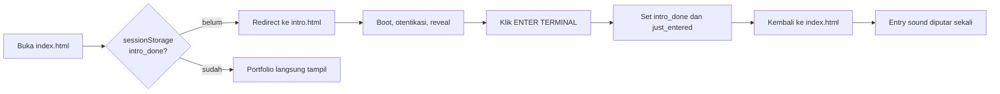

# 🌌 Swallowed Star Portfolio: Kavin Thoriq


Website portfolio pribadi bertema **sci-fi HUD terminal** dengan inspirasi dari anime **Swallowed Star (Tunshi Xingkong)** dan karakter **Luo Feng**. Dibangun dengan HTML, CSS, dan JavaScript murni tanpa framework, build tool, maupun dependensi npm.

🔗 **Demo:** [kavinthoriq.my.id](https://kavinthoriq.my.id) · alternatif: [kavinthoriq.github.io/Portfolio](https://kavinthoriq.github.io/Portfolio)

<!-- Tambahkan screenshot di sini setelah situs live, misalnya:


-->

## 📑 Daftar Isi

- [Fitur](#-fitur)
- [Alur Halaman](#-alur-halaman)
- [Sertifikasi](#-sertifikasi)
- [Proyek yang Ditampilkan](#️-proyek-yang-ditampilkan)
- [Teknologi](#️-teknologi)
- [Struktur Repository](#-struktur-repository)
- [Cara Menjalankan](#-cara-menjalankan)
- [Deploy ke GitHub Pages](#-deploy-ke-github-pages)
- [Menambah Proyek atau Sertifikat](#-menambah-proyek-atau-sertifikat)
- [Kustomisasi](#️-kustomisasi)
- [Catatan & Troubleshooting](#-catatan--troubleshooting)
- [Author](#-author)
- [Kredit & Disclaimer](#-kredit--disclaimer)

---

## ✨ Fitur

### 🎬 Cinematic Intro (`intro.html`)
- Wallpaper karakter Luo Feng layar penuh dengan starfield partikel (canvas) dan bingkai sudut ala HUD.
- Jam dan tanggal realtime pada status bar atas.
- Urutan tiga fase: boot terminal dengan teks diketik otomatis, otentikasi dengan teks *glitch*, lalu tombol **[ ENTER TERMINAL ]**.
- Cincin hologram yang muncul di fase akhir, ticker teks berjalan di bagian bawah, dan tombol mute audio.
- Efek suara Web Audio API di tiap fase (ketikan terminal, pulsa energi, *cosmic reveal*, dan ledakan saat masuk).
- Bisa masuk dengan klik tombol, tombol **Enter** atau **Spasi**, dan keluar cepat dengan **Esc**.

### 💼 Portfolio (`index.html`)
- **Hero:** teks ketik otomatis (*typewriter*), identitas operator, dan tombol navigasi cepat.
- **Bio-Scan (Tentang):** deskripsi diri, info pribadi, statistik animasi, dan grafik radial kemampuan.
- **Mission Log (Pendidikan):** riwayat sekolah dan pengalaman utama dalam bentuk kartu "mission" pada garis waktu.
- **Atribut (Skill):** *hard skill* dan *soft skill* dengan bar animasi, serta daftar teknologi yang dikuasai.
- **Sertifikasi:** kartu sertifikat dengan pratinjau gambar dan lightbox. Datanya dikelola dari satu file. 🆕
- **Projects:** kartu proyek dengan filter **All / Web / Game / Design**, lengkap dengan tombol demo dan source code. Datanya dikelola dari satu file.
- **Transmit (Kontak):** GitHub, email, dan lokasi, plus ajakan kolaborasi.
- **Ticker** informasi berjalan dan footer bergaya terminal di bagian bawah.

### 🏅 Lightbox Sertifikat 🆕
- Klik kartu atau tombol **LIHAT SERTIFIKAT** untuk membuka pratinjau besar beserta penerbit, tanggal, dan penandatangan.
- Tutup dengan tombol **TUTUP**, klik area gelap, atau tombol **Esc**.
- Fokus keyboard terkunci di dalam dialog dan dikembalikan ke elemen pemicu saat ditutup, scroll halaman dikunci selama dialog terbuka.
- Gambar yang gagal dimuat diganti placeholder `[ NO IMAGE ]`.

### 🎮 Interaksi & Efek
- **Cursor kustom bertema singularity:** inti dengan cincin berputar dan bulan orbit emas, bereaksi saat hover dan klik. Hanya aktif di perangkat dengan mouse dan menghormati `prefers-reduced-motion`.
- **Sound effect** (Web Audio API) untuk hover, klik, dan navigasi, dengan tombol mute. Tanpa file audio eksternal.
- **Entry sound** yang diputar sekali ketika pengunjung baru masuk dari intro.
- Animasi muncul saat scroll (*scroll reveal*), penghitung angka animasi, dan efek kaca (*glassmorphism*) pada panel.
- Layout responsif dengan menu mobile (hamburger).

### ♿ Aksesibilitas
- Atribut ARIA pada dialog, daftar, dan tombol filter (`aria-pressed`).
- Fokus keyboard terlihat jelas pada tombol dan kartu yang bisa diklik.
- Animasi dikurangi untuk pengguna dengan preferensi `prefers-reduced-motion`.

---

## 🧭 Alur Halaman

Pengunjung baru otomatis diarahkan ke intro. Setelah menekan **ENTER TERMINAL**, portfolio terbuka dan intro tidak diulang selama sesi tab yang sama.



> Ingin menonton intro lagi? Buka situs di tab baru, atau jalankan `sessionStorage.clear()` di Console browser lalu muat ulang halaman.

---

## 🏅 Sertifikasi

| ID | Sertifikat | Penerbit | Tanggal | Penandatangan |
| --- | --- | --- | --- | --- |
| C-001 | Java Fundamentals – Bahasa Indonesia (Award of Completion) | Oracle Academy | 7 November 2026 | M. Wijaya Saputra (Oracle Academy Instructor) |
| C-002 | Database Foundations – Bahasa Indonesia (Award of Completion) | Oracle Academy | 20 November 2026 | M. Wijaya Saputra (Oracle Academy Instructor) |

---

## 🗂️ Proyek yang Ditampilkan

| ID | Proyek | Kategori | Teknologi | Status | Demo | Repo |
| --- | --- | --- | --- | --- | --- | --- |
| P-001 | Go To School: Mathemagic Adventure | Game | RPG Maker MZ, JavaScript | Completed | [Main](https://kavinthoriq.github.io/go-to-school-mathemagic-adventure/) | [Repo](https://github.com/kavinthoriq/go-to-school-mathemagic-adventure) |
| P-002 | PlengerToSmart | Web | PHP, MySQL | In Progress | [Buka](https://edukasi-vynz.page.gd/) | [Repo](https://github.com/kavinthoriq/edukasi) |
| P-003 | Geometry Dash (Fan Game) | Game | Scratch | Completed | [Main](https://kavinthoriq.github.io/geometry-dash/) | [Repo](https://github.com/kavinthoriq/geometry-dash) |
| P-004 | Vynz News | Web | HTML, CSS, JavaScript | Completed | [Buka](https://kavinthoriq.github.io/vynz-news/) | [Repo](https://github.com/kavinthoriq/vynz-news) |
| P-005 | StudyNote | Design | Figma | Completed | - | [Repo](https://github.com/kavinthoriq/note-app) |
| P-006 | SMK TI Dwiguna — Website Design | Design | Figma | Completed | - | [Repo](https://github.com/kavinthoriq/smk.sch.id) |

---

## 🛠️ Teknologi

| Teknologi | Kegunaan |
| --- | --- |
| HTML5 | Struktur halaman |
| CSS3 | Tema HUD, animasi, glassmorphism, dan layout responsif, dipecah per komponen dan per section |
| JavaScript (Vanilla) | Interaksi, filter proyek, lightbox, cursor kustom, dan scroll reveal |
| Canvas API | Starfield, partikel latar, dan grafik radial |
| Web Audio API | Sound effect tanpa file audio eksternal |
| IntersectionObserver | Animasi saat elemen terlihat |
| sessionStorage | Penanda sesi intro agar tidak diulang |
| Tailwind CSS (CDN) | Styling pada halaman intro saja |
| Google Fonts | Orbitron, Share Tech Mono, dan Inter |

**Palet warna:** cyan `#00f5ff`, emas `#ffd700`, biru `#0099ff`, hijau terminal `#00ff88`, ungu `#b400ff`, latar `#020812`.

---

## 📁 Struktur Repository

CSS, JavaScript, data, dan aset dipisah dari HTML agar mudah dirawat.

```
├── index.html                      # Halaman utama portfolio
├── intro.html                      # Cinematic intro (pintu masuk)
├── CNAME                           # Domain kustom GitHub Pages
├── README.md
├── .gitignore
├── assets/
│   ├── css/
│   │   ├── base.css                # Variabel warna, reset, scrollbar, layout, scroll reveal
│   │   ├── components.css          # Komponen bersama: glass, HUD box, tombol, badge
│   │   ├── cursor.css              # Gaya cursor kustom
│   │   ├── intro.css               # Gaya khusus intro.html
│   │   └── sections/               # Satu file per section
│   │       ├── navbar.css
│   │       ├── hero.css
│   │       ├── about.css
│   │       ├── education.css
│   │       ├── skills.css
│   │       ├── certificates.css
│   │       ├── projects.css
│   │       ├── contact.css
│   │       └── footer.css
│   ├── js/
│   │   ├── shared/                 # Dipakai di intro.html dan index.html
│   │   │   ├── starfield.js        # Canvas bintang
│   │   │   ├── hud-clock.js        # Jam dan tanggal realtime
│   │   │   └── audio-engine.js     # Mesin audio Web Audio API
│   │   ├── intro/
│   │   │   └── intro.js            # Urutan fase intro dan tombol masuk
│   │   └── main/                   # Khusus index.html
│   │       ├── intro-gate.js       # Dokumentasi saja (kodenya inline di index.html)
│   │       ├── entry-sound.js      # Suara masuk sekali setelah intro
│   │       ├── navigation.js       # Navbar, scroll ke section, menu mobile
│   │       ├── typewriter.js       # Teks ketik di hero
│   │       ├── reveal.js           # Scroll reveal, counter, grafik radial
│   │       ├── projects.js         # Render kartu proyek dan filter
│   │       ├── certificates.js     # Render kartu sertifikat dan lightbox
│   │       ├── sfx.js              # Suara hover dan klik
│   │       └── cursor.js           # Cursor kustom singularity
│   └── img/
│       ├── characters/             # luo-feng.webp, luo-feng-full.webp
│       ├── projects/               # Screenshot proyek (6 gambar)
│       └── certificates/           # Pratinjau sertifikat (2 gambar)
├── data/
│   ├── projects.js                 # Data proyek (window.PROJECTS)
│   └── certificates.js             # Data sertifikat (window.CERTIFICATES)
└── docs/
    └── certificates/               # Berkas sertifikat untuk diunduh
```

> Buka `index.html` untuk pengalaman lengkap, pengunjung baru otomatis diarahkan ke intro. Kamu juga bisa langsung membuka `intro.html`.

---

## 🚀 Cara Menjalankan

Tanpa instalasi apa pun, tanpa `npm`, dan tanpa server khusus:

1. **Clone repository**
   ```bash
   git clone https://github.com/kavinthoriq/Portfolio.git
   cd Portfolio
   ```
2. **Buka `index.html`** di browser (klik dua kali), atau gunakan ekstensi **Live Server** di VS Code.
3. Klik **[ ENTER TERMINAL ]** untuk masuk ke portfolio.

Semua script memakai `<script defer>` klasik (bukan ES modules), jadi situs tetap berjalan saat dibuka langsung lewat `file://`.

---

## 🌐 Deploy ke GitHub Pages

1. Push project ke GitHub (branch `main`).
2. Buka **Settings → Pages**, pilih **Deploy from a branch**, branch `main`, folder `/ (root)`, lalu **Save**.
3. Tunggu 1–3 menit, lalu cek status di tab **Actions**.

Tidak perlu mengganti nama file. `index.html` tetap menjadi halaman awal dan otomatis mengarahkan pengunjung baru ke `intro.html`.

**Domain kustom:** file `CNAME` berisi domain yang dipakai. Jika tidak ingin memakai domain kustom, hapus file `CNAME` dan kosongkan kolom *Custom domain* di Settings → Pages.

---

## 🧩 Menambah Proyek atau Sertifikat

Kode render dan data sudah dipisah, jadi menambah konten cukup mengedit satu file data.

### Proyek baru

1. Taruh screenshot di `assets/img/projects/` dengan nama huruf kecil tanpa spasi (contoh `nama-proyek.png`).
2. Tambah satu objek di `data/projects.js`:

```js
{
  id:     'P-007',
  title:  'Nama Proyek',
  desc:   'Deskripsi singkat proyek.',
  tags:   ['Web', 'HTML', 'CSS'],   // 'Web' / 'Game' / 'Design' dipakai oleh filter
  img:    'assets/img/projects/nama-proyek.png',
  demo:   'https://link-demo',      // kosongkan '' jika tidak ada
  repo:   'https://github.com/kavinthoriq/nama-repo',
  status: 'COMPLETED',              // atau 'IN PROGRESS'
  year:   '2026'
}
```

Filter cocok dengan **tag mana pun** yang bernilai `Web`, `Game`, atau `Design`. Angka statistik **PROYEK** di bagian Bio-Scan ikut bertambah otomatis.

### Sertifikat baru

1. Taruh gambar pratinjau di `assets/img/certificates/` dan berkas unduhan (opsional) di `docs/certificates/`.
2. Tambah satu objek di `data/certificates.js`:

```js
{
  id:         'C-003',
  title:      'Nama Sertifikat',
  issuer:     'Penerbit',
  date:       '1 Januari 2027',
  dateISO:    '2027-01-01',
  signer:     'Nama Penandatangan',
  signerRole: 'Jabatan',
  award:      'Award of Completion',
  desc:       'Deskripsi singkat sertifikat.',
  tags:       ['Tag 1', 'Tag 2'],
  img:        'assets/img/certificates/nama-sertifikat.png',
  pdf:        'docs/certificates/nama-sertifikat.pdf'   // kosongkan '' jika tidak ada tombol unduh
}
```

---

## ⚙️ Kustomisasi

- **Warna tema:** ubah variabel CSS di `:root` pada `assets/css/base.css` (halaman intro punya `:root` sendiri di `assets/css/intro.css`).
- **Cursor kustom:** konstanta di bagian **KONFIGURASI** pada `assets/js/main/cursor.js` (`ENABLED`, `ORBIT_MOON`, `CORE_SIZE`, `RING_SIZE`, `ROT_SPEED`, dan lainnya). Setel `ENABLED = false` untuk mematikannya.
- **Urutan intro:** waktu dan teks tiap fase ada di `assets/js/intro/intro.js`.
- **Volume dan mute:** diatur lewat tombol SFX di pojok kanan bawah.
- **Isi konten:** teks Bio-Scan, Mission Log, dan Atribut ada langsung di `index.html`.

---

## 📝 Catatan & Troubleshooting

| Masalah | Penyebab dan solusi |
| --- | --- |
| Gambar atau CSS tidak muncul setelah deploy | GitHub Pages **membedakan huruf besar dan kecil**. Samakan penulisan path dengan nama file asli. |
| Perubahan belum terlihat | Tunggu proses di tab **Actions** selesai, lalu tekan **Ctrl + F5**. |
| Intro tidak muncul lagi | Intro hanya sekali per sesi tab. Buka tab baru atau jalankan `sessionStorage.clear()`. |
| Tidak ada suara | Browser memblokir audio sebelum ada interaksi. Klik atau tekan tombol sekali, lalu cek tombol SFX tidak dalam keadaan mute. |
| Cursor kustom tidak tampil | Memang hanya aktif di perangkat dengan mouse dan tidak aktif saat `prefers-reduced-motion` menyala. |

> Disarankan memakai nama file huruf kecil tanpa spasi (kebab-case) untuk semua aset baru.

---

## 👤 Author

**Kavin Thoriq**
Pelajar PPLG, SMK TI Dwiguna Kota Depok
- GitHub: [@kavinthoriq](https://github.com/kavinthoriq)

---

## 📜 Kredit & Disclaimer

Website ini adalah karya penggemar (*fan tribute*) dan tidak berafiliasi dengan pemilik resmi **Swallowed Star**. Karakter, gambar, dan kutipan Luo Feng adalah milik pemilik hak ciptanya. Jika repository ini dipublikasikan secara luas, pastikan kamu memiliki hak pakai atas gambar tersebut atau menggantinya dengan aset buatan sendiri.

Sertifikat yang ditampilkan adalah milik Kavin Thoriq dan diterbitkan oleh Oracle Academy. Nama dan logo pihak penerbit adalah milik masing-masing pemiliknya.

---

⭐ Kalau portfolio ini bermanfaat, jangan lupa kasih **star** di repository ini!
